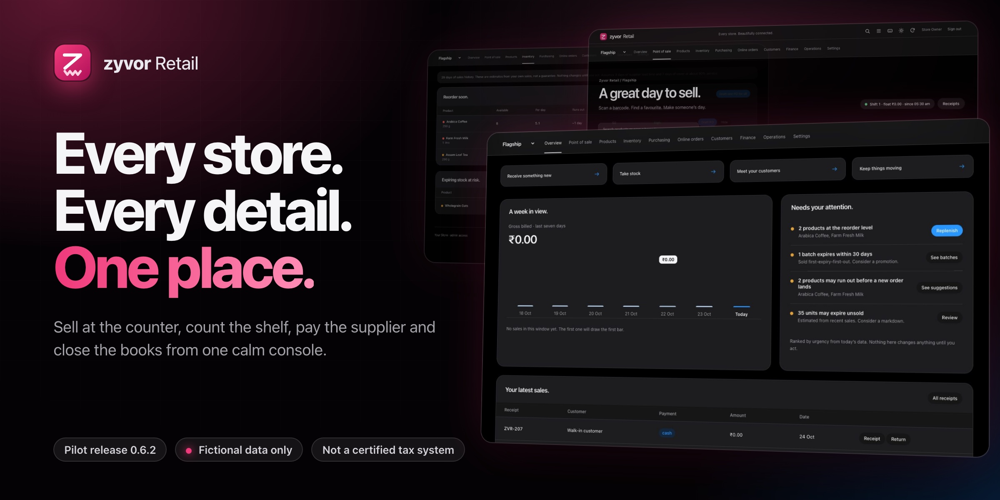

<div align="center">



# Zyvor Retail

### Every store. Every detail. One place.

**Sell at the counter, count the shelf, pay the supplier and close the books from one calm console. Built for a company that runs several stores.**

[](docs/INTENDED-USE.md) [](https://zyvorai.github.io/zyvor-retail-site/) [](docs/INTENDED-USE.md) [](docs/INTENDED-USE.md) [](docs/MODULES.md) [](docs/GETTING-STARTED.md)

[**Try it on your computer**](https://zyvorai.github.io/zyvor-retail-site/try/) · [**Live demo**](https://zyvorai.github.io/zyvor-retail-site/#demo) · [**Watch**](https://zyvorai.github.io/zyvor-retail-site/#watch) · [**Docs**](docs/README.md) · [**Ask about a pilot**](mailto:sales@zyvor.dev?subject=Zyvor%20Retail%20pilot)

</div>

> [!IMPORTANT]
> **Zyvor Retail is a pilot release with a working core.** It uses **fictional data only** and is **not a certified tax or accounting system**: pilot tax invoices, GSTR worksheets and stub IRN/e-Way are included; no live GSTN filing, no certified tax system, no live payment gateway. Start with a controlled pilot whose workflows match the implemented scope. Read [Intended use and limits](docs/INTENDED-USE.md).

This repository is the **public home of the Zyvor Retail website**. The application source is private; you can ask for access to evaluate it.

| **10** workspaces, from point of sale to settings | **5** staff roles, scoped to branch | **0** runtime packages, CDNs or build steps | **267** automated tests in the repository |
|:---:|:---:|:---:|:---:|

---

## Watch it

[](media/walkthrough.mp4)

**A trading day in thirty-four seconds.** Recorded on the running app, fictional data, no sound. ([Open the video](media/walkthrough.mp4), or watch it on the [website](https://zyvorai.github.io/zyvor-retail-site/#watch).)

## See it

Real screens from the running application. The catalogue, prices and stock shown are fictional. Light and dark follow your system setting.

| Overview | Point of sale |
|:---:|:---:|
| <picture><source media="(prefers-color-scheme: dark)" srcset="shots/dark-overview.jpg"></picture> | <picture><source media="(prefers-color-scheme: dark)" srcset="shots/dark-pos.jpg"></picture> |
| **Inventory** | **Suggestions** |
| <picture><source media="(prefers-color-scheme: dark)" srcset="shots/dark-inventory.jpg"></picture> | <picture><source media="(prefers-color-scheme: dark)" srcset="shots/dark-suggestions.jpg"></picture> |

<details>
<summary><b>More screens</b></summary>

| Products | Finance |
|:---:|:---:|
| <picture><source media="(prefers-color-scheme: dark)" srcset="shots/dark-products.jpg"></picture> | <picture><source media="(prefers-color-scheme: dark)" srcset="shots/dark-finance.jpg"></picture> |
| **Pickup storefront** | **Sign in** |
| <picture><source media="(prefers-color-scheme: dark)" srcset="shots/dark-shop.jpg"></picture> | <picture><source media="(prefers-color-scheme: dark)" srcset="shots/dark-login.jpg"></picture> |

All of them: **[Gallery](docs/GALLERY.md)**.

</details>

---

## Built for the whole shop

- **At the counter.** Scan or search, pick a customer, take cash, card or UPI (including cash+UPI split), print a tax invoice. Partial returns reverse the original sale exactly, with the right batch and a credit note.
- **In the back room.** Receive against a purchase order, capture batch, expiry and input tax, count the shelf, transfer between stores. Expired stock is blocked and sold first-expiry-first-out.
- **In the office.** Every movement posts to a double-entry ledger. Trial balance, margin, supplier balances, GSTR-1 CSV, shifts and tasks, and exports your accountant can open.

### Made for speed

- **Tells you what to do next.** The overview ranks what needs attention (expired stock, low stock, pickup requests, due tasks) with one clear action per item.
- **Keyboard first.** Scan a barcode and it is in the bag. `/` searches, `+` and `-` change quantity, `Cmd+K` finds anything, `?` lists every shortcut.
- **Change due, instantly.** Type the cash received and see the change, or how much is short.
- **Calm when things go wrong.** Offline or a failed refresh shows a clear banner with the time of the last good data. Pending sales wait safely.

## What a trading day needs

| Module | What it covers |
|---|---|
| **Point of sale** | Barcode keyboard input, product search, customers, manager discounts, promotion codes, cash, card and UPI (including cash+UPI split), printable tax invoices, shifts with counted-versus-expected cash |
| **Catalogue** | SKU and barcode uniqueness, packs, categories, prices, tax rates, HSN, reorder levels, CSV import from the browser or the command line |
| **Inventory** | Batches, expiry blocking, FEFO selling, adjustments at actual batch cost, transfers between stores, stock-count sessions that detect conflicts, reorder and expiry suggestions that show their arithmetic |
| **Purchasing** | Suppliers, multi-line purchase orders, partial receipts with input tax, unique invoice numbers, replenishment drafts, supplier returns against credits |
| **Pickup storefront** | A public catalogue with product sheets, a bag that counts, and a pickup request that ends in a clear timeline |
| **Customers and loyalty** | One company-wide directory with a consent flag; one point earned per ₹100, reversed if the sale is returned |

Every row is implemented and covered by the repository's tests. Details: **[Modules](docs/MODULES.md)**.

## The books

**Stock and money cannot disagree.** A sale, a receipt, a write-off and a return each write to the stock ledger and to the double-entry journal in the same transaction, so there is no end-of-day sync to forget. Quoted prices and discounts are checked again at commit, and a retried checkout is idempotent and never consumes a promotion twice. **Pilot tax invoices and GSTR-1 CSV are included; this is not certified GST, not e-invoicing, and not a certified accounting system.**

## Security

Hashed passwords, opaque HttpOnly sessions, CSRF protection, persistent throttle counters and session revocation. Optional OpenID Connect SSO (off by default). Five roles with branch scope, checked on the server. An Envoy edge with HTTPS, redirects, token buckets, body and header limits, timeouts and private routes for backup and metrics. **No independent security review has been done yet.** See **[Security overview](docs/SECURITY-OVERVIEW.md)**, and [SECURITY.md](SECURITY.md) to report a vulnerability.

## From a laptop to a cluster

| Local | Compose with HTTPS | Kubernetes |
|---|---|---|
| Python 3.12 with SQLite. One command, no packages, no build step, nothing leaves your machine. | A standalone stack with Envoy terminating TLS, redirects, rate limits and private operations routes. | Non-root pods, probes, default-deny network policies, data and backup volumes, an edge-only autoscaler and a scheduled verified backup. |

---

## Try the live demo

A running copy with a fictional store: four weeks of sales, low stock, a pickup request and an expiring batch are already there, so the reorder suggestions have something to work from.

- **Storefront**, no login needed: browse, search, add to the bag and send a pickup request. Nothing is charged online.
- **Staff console**, login on request: [ask for one](mailto:sales@zyvor.dev?subject=Zyvor%20Retail%20demo%20login&body=Hi%2C%20please%20send%20me%20the%20demo%20login%20for%20Zyvor%20Retail.%0A%0AName%3A%0ACompany%3A). It is a cashier account.
- **Please note:** every visitor shares the same fictional data, so you may see other people's test sales. It is a shared demo on a test machine, not for real customer data.

Open it from the **[website](https://zyvorai.github.io/zyvor-retail-site/#demo)**. A 60-second tour is in **[Getting started](docs/GETTING-STARTED.md#sixty-seconds-what-to-click)**.

## Try it on your computer

One command, about five minutes, Mac / Windows / Linux. Guided steps: **[Try it](https://zyvorai.github.io/zyvor-retail-site/try/)**.

```bash
curl -fsSL https://github.com/zyvorai/zyvor-retail-site/releases/latest/download/get.sh | sh -s -- up --demo
```

Windows PowerShell uses `get.ps1` (WSL 2). The installer prints a one-time password and opens `http://127.0.0.1:8080`. More: **[Getting started](docs/GETTING-STARTED.md)** · **[Releases](docs/RELEASES.md)**.

Evaluators who need the private source can still [ask sales for a ZIP](mailto:sales@zyvor.dev?subject=Zyvor%20Retail%20pilot).

## Honest limits

- **Maturity.** A pilot release with a working core. Pilot it alongside your existing process first.
- **Tax and statutory.** Pilot tax invoices, CGST/SGST/IGST and GSTR-1 CSV are included. Not certified GST, not e-invoicing, not live GSTN filing, no period close or year-end. **Not a certified accounting system.**
- **Payments and hardware.** Tenders are recorded, not initiated. Cash+UPI split is supported. No payment gateway, credit sales, calibrated scales or fiscal printer drivers.
- **Offline.** Service worker caches the console shell; a loaded tab keeps a pending checkout for manual retry. It is not a full offline POS.
- **Suggestions.** Statistical estimates from your own sales, not a trained model. Nothing is ordered or marked down unless a person submits it.
- **Storefront.** Pickup only: no online payment, accounts, delivery, reserved stock or order tracking.
- **Security.** No independent review yet, no MFA of its own, no audit signing, no encrypted application fields. Optional OIDC SSO is available and off by default.
- **Scale.** One application instance on SQLite. No high availability and no PostgreSQL migration yet.

The full table and what is not built yet: **[Intended use and limits](docs/INTENDED-USE.md)**.

---

## Documentation

| | |
|---|---|
| [Getting started](docs/GETTING-STARTED.md) | One-command trial, live demo, source ZIP |
| [Try it](https://zyvorai.github.io/zyvor-retail-site/try/) | Guided Mac / Windows / Linux install |
| [FAQ](docs/FAQ.md) | Can I run my real shop on it, AI, internet, stores, data, source |
| [Modules](docs/MODULES.md) | Everything a trading day needs, and what is not built yet |
| [Security overview](docs/SECURITY-OVERVIEW.md) | Controls you can point at, and what has not been done |
| [Intended use and limits](docs/INTENDED-USE.md) | What Zyvor Retail is not, yet |
| [Gallery](docs/GALLERY.md) | Every screen, light and dark |

## Feedback and contact

- **Pilots and demos:** [sales@zyvor.dev](mailto:sales@zyvor.dev?subject=Zyvor%20Retail%20pilot)
- **Security:** [security@zyvor.dev](mailto:security@zyvor.dev?subject=Zyvor%20Retail%20security%20questions)
- **GitHub issues** are welcome for feedback. **Never include customer data, passwords or payment details.** See [CONTRIBUTING.md](CONTRIBUTING.md).

---

<div align="center">

<sub>Zyvor Retail is built by [Zyvor AI Labs](https://zyvor.dev), who also make [ZYVORA, the hospital OS](https://zyvorai.github.io/zyvor-zyvora-site/). Release 0.24.0 pilot. All screens use fictional data. No application source is published here.</sub>

</div>
